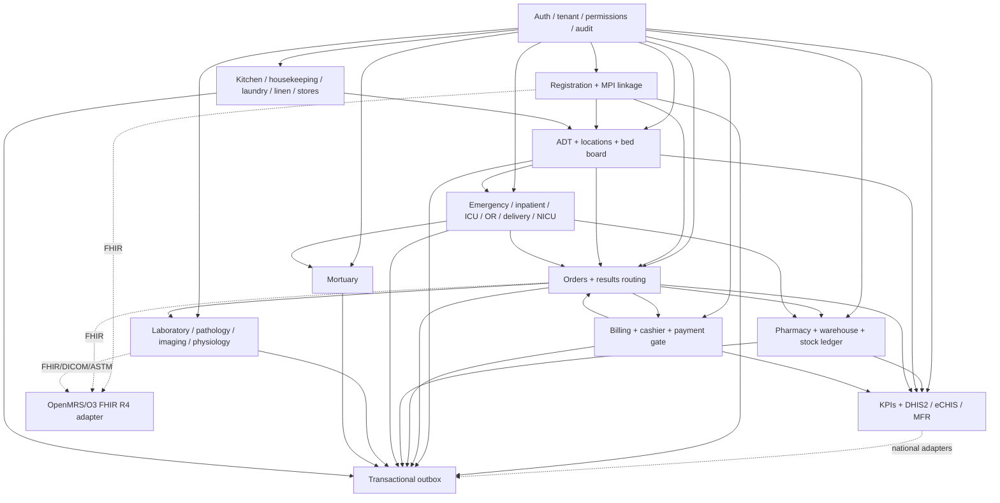

# HMS Module Dependency Map

The HMS is a modular monolith. Solid arrows are application-service/event
dependencies; dotted arrows are adapter boundaries. Modules do not read one
another's tables directly.

Safety/privacy guards are cross-cutting: emergency care bypasses payment gates,
radiation orders require the pregnancy-safety workflow, mortuary records are
permissioned, and billing/support roles receive minimum-necessary identity and
operational data only.
